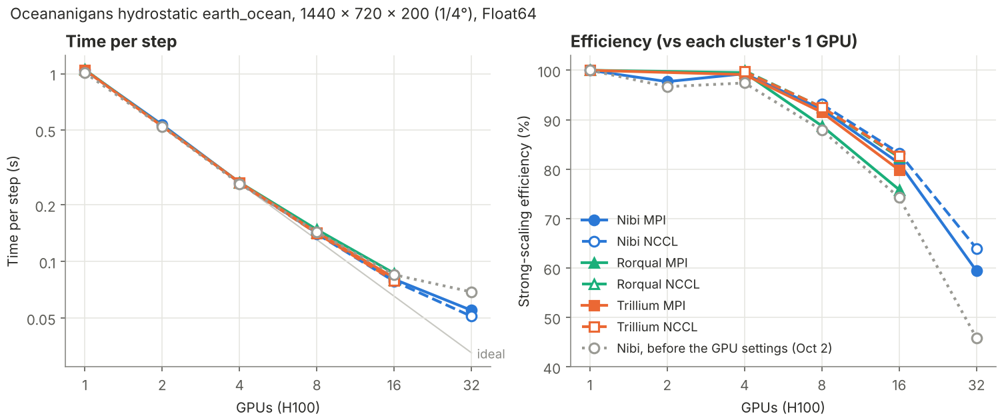

# Using the Digital Research Alliance of Canada's GPU clusters (Nibi, Fir, Rorqual, Trillium)

## Overview

The Digital Research Alliance of Canada (DRAC) runs several national GPU clusters with
NVIDIA H100 80 GB GPUs, a common software stack (`/cvmfs`, `StdEnv/2023`) and Slurm. The
same scripts work on all of them; only the Slurm node options differ:

| Cluster | GPUs per node | Slurm options |
| --- | --- | --- |
| [Nibi](https://docs.alliancecan.ca/wiki/Nibi) | 8 | step 6 |
| [Fir](https://docs.alliancecan.ca/wiki/Fir) | 4 | step 6 |
| [Rorqual](https://docs.alliancecan.ca/wiki/Rorqual) | 4 | step 6 |
| [Trillium](https://docs.alliancecan.ca/wiki/Trillium_Quickstart) (GPU) | 4 | section 11 (1 GPU or whole nodes) |

`jobs/submit_gpu.sh` chooses these options for you; `jobs/gpu_request.sh` is the one place where
they are written, and an automatic check keeps the tables in this guide in line with it.

This post covers running Oceananigans on these clusters, from a first CPU job to multi-node
GPU runs: installing packages, setting up CUDA-aware MPI, Slurm scripts, checking that the
setup is correct, and scaling results. All the scripts are in the
[oceananigans-hpc](https://github.com/francispoulin/oceananigans-hpc) repository, which
is tested and kept up to date. Please comment below if something doesn't work.

**Three things that save time:**

- **Login nodes have internet access but no GPUs.** Install packages on a login node;
  `nvidia-smi` failing there is normal.
- **Keep the Julia depot and your clones off `$SCRATCH`**, which is purged, and **set the
  depot after loading modules** (step 2).
- **Precompile at most two packages at a time on login nodes.** The default (one per core)
  starts more threads than a login node allows and crashes with `Resource temporarily
  unavailable`. `env/drac.sh` sets `JULIA_NUM_PRECOMPILE_TASKS=2`.
- **Multi-GPU runs need Julia to use the system OpenMPI throughout** (step 3, plus
  `OPAL_PREFIX`, set by `env/drac.sh`; see step 7). Otherwise they crash at `MPI.Init()`,
  typically as soon as NetCDF output is involved.
  

## 1. Get the scripts

```bash

cd /project/<group>/$USER      # project space (step 2), or $HOME; not $SCRATCH, which is purged
git clone https://github.com/francispoulin/oceananigans-hpc.git
cd oceananigans-hpc
```

Tell Slurm which allocation to charge, once, in your `~/.bashrc`:

```bash
export SBATCH_ACCOUNT=def-yourpi     # your group's allocation
export SALLOC_ACCOUNT=$SBATCH_ACCOUNT
```

The commands below assume this is set; otherwise add `--account=def-yourpi` to each `sbatch`.

## 2. Environment and Julia depot

Every step uses `env/drac.sh`, which loads the modules (`StdEnv/2023`, `gcc/12.3`,
`openmpi/4.1.5`, `cuda/12.6`), puts our own Julia on `PATH` (below) and sets the Julia depot: the
folder where packages and compiled code are stored.  It is `$HOME/julia_depot` unless you set `JULIA_DEPOT_PATH` before sourcing the file. It starts with `module --force purge`, so modules loaded at login (including "sticky" ones) don't leak into jobs.

**Where to put the depot.** A depot with Oceananigans, CUDA and MPI is about 2 GB and
12,000 files. If your group has project space, put it there:
`/project/<group>/<user>/julia_depot` (the same path on Nibi, Fir and Rorqual). The space
and its quota are shared by your whole group, so check `diskusage_report` first. `$HOME`
also works (50 GB). Avoid `$SCRATCH`: files not accessed for 60 days are purged, which can
break the depot. Always refer to the depot by the same path, as Julia may recompile
everything if the path changes. Set it in your `~/.bashrc`, **after** any `module load`
lines:

```bash
export JULIA_DEPOT_PATH=/project/<group>/<user>/julia_depot
```
Log in again (or run `source ~/.bashrc`) before step 3, and check with `echo $JULIA_DEPOT_PATH`.

**Why the order matters.** The `julia` module (used until our own Julia is installed, step 3) runs
`append_path("JULIA_DEPOT_PATH", ":")`, so every time it is loaded it adds a colon to the depot path. Julia reads empty entries in
the depot path as "add the default depots here", and those include `~/.julia` in your home
directory. Packages can then come from, or be written to, an unexpected place. Setting the
variable after loading modules replaces whatever the module added, and `env/drac.sh` strips
it in jobs.

## 3. One-time setup (login node)

```bash
bash setup/install_julia.sh     # our own Julia 1.10.10, about 1 GB, next to the depot
bash setup/setup.sh
```

**Julia: our own install, not the module.** `setup/install_julia.sh` downloads the official
release that `Manifest.toml` was made with (`julia_version`), checks it against julialang.org's
checksums, and unpacks it in a folder `software` next to the depot (for example
`/project/<group>/<user>/software/julia-1.10.10`; set `OCEAN_SOFTWARE_DIR` to put it elsewhere), then
adapts it with the Alliance's `setrpaths.sh`: the programs then use the software stack's own loader
(as the module's Julia does), without which the cluster's `libmpi` fails to load
(`libze_loader.so.1: cannot open shared object file`). The code is unchanged.
`env/drac.sh` then puts it on `PATH`. Every machine, Alliance or not, runs the same binary, and a new
Julia version is a new Manifest and one command, not a wait for a module. Until it is installed,
`env/drac.sh` loads the `julia` module of the same version and says so; `tools/check_env.sh` shows
which one is used. Trillium jobs read it from `/project` like the depot.

The first run downloads and precompiles everything; allow 20 to 30 minutes. It does four
things:

1. **Installs the tested package versions** from the repository's `Manifest.toml`
   (Oceananigans, CUDA, MPI, NCDatasets, JLD2).
2. **Makes MPI.jl use the system OpenMPI**, which is built for the cluster's network and for
   Slurm. DRAC modules don't set `LD_LIBRARY_PATH`, so `MPIPreferences.use_system_binary()`
   can't find `libmpi` by searching; the script passes the module's `lib` folder as
   `extra_paths`.
3. **Redirects Julia's own OpenMPI to the system library.** NetCDF and HDF5 output packages
   load `OpenMPI_jll`, Julia's own copy of OpenMPI. Without the redirect, two MPIs end up in
   one process. The redirect only works when both are the same series, so the repository
   restricts `OpenMPI_jll` to **4.1.10 or later in the 4.1 series**, matching the `openmpi/4.1.5` module;
   the newest `OpenMPI_jll` (5.x) fails with `undefined symbol: ompi_instance_count`.
4. **Precompiles.**

The key lines of the output:

```
┌ Info: MPI implementation identified
│   libmpi = "/cvmfs/soft.computecanada.ca/easybuild/software/2023/x86-64-v4/Compiler/gcc12/openmpi/4.1.5/lib/libmpi"
│   version_string = "Open MPI v4.1.5, ..."
...
== 3. OpenMPI_jll -> system OpenMPI library
   OpenMPI_jll.libmpi_path = /cvmfs/soft.computecanada.ca/easybuild/software/2023/x86-64-v4/Compiler/gcc12/openmpi/4.1.5/lib/libmpi.so
```

Both paths must be under `/cvmfs`, not in your Julia depot. The setup writes
`LocalPreferences.toml`, which holds these machine-specific settings.

## 4. Hello on a CPU node

```bash
sbatch jobs/hello_cpu.sh
```

`hello_cpu_<jobid>.out` should end with:

```
[ Info: hello from Oceananigans on CPU!
grid = 8×8×8 RectilinearGrid{Float64, Periodic, Periodic, Bounded} on CPU with 3×3×3 halo
├── Periodic x ∈ [0.0, 1.0)  regularly spaced with Δx=0.125
├── Periodic y ∈ [0.0, 2.0)  regularly spaced with Δy=0.25
└── Bounded  z ∈ [-3.0, 0.0] regularly spaced with Δz=0.375
c = 8×8×8 Field{Center, Center, Center} on RectilinearGrid on CPU
...
    └── max=2.625, min=-2.625, mean=0.0
```

## 5. Hello on one GPU

```bash
sbatch jobs/hello_gpu.sh
```

The same grid and field, now on `CUDAGPU`:

```
[ Info: hello from Oceananigans on GPU!
grid = 8×8×8 RectilinearGrid{Float64, Periodic, Periodic, Bounded} on CUDAGPU with 3×3×3 halo
...
└── data: 14×14×14 OffsetArray(::CuArray{Float64, 3, CUDACore.DeviceMemory}, ...)
    └── max=2.625, min=-2.625, mean=0.0
```

## 6. Multi-GPU checks

`jobs/checks.sh` runs four checks on any number of GPUs, one MPI rank per GPU. Submit it with
`jobs/submit_gpu.sh`, which picks the Slurm options for the cluster you are on:

```bash
bash jobs/submit_gpu.sh jobs/checks.sh 2      # 2 GPUs
bash jobs/submit_gpu.sh jobs/checks.sh 8      # a full Nibi node (2 nodes on Fir and Rorqual)
bash jobs/submit_gpu.sh jobs/checks.sh 16     # two Nibi nodes
```

It prints the `sbatch` command it runs (`DRYRUN=1` prints it without submitting), and any options
after the number of GPUs go to `sbatch` unchanged (`--time=...`, `--export=...`). It works for the
other GPU job scripts too (`jobs/benchmark*.sh`, or a copy of `checks.sh` with your own script).

**Without the wrapper.** Plain `sbatch` works the same way if you give the GPU options yourself:

| GPUs | Nibi (8 per node) | Fir, Rorqual (4 per node) |
| --- | --- | --- |
| 2 | `--nodes=1 --ntasks-per-node=2 --gpus-per-node=h100:2 --mem=64G` | same |
| 4 | `--nodes=1 --ntasks-per-node=4 --gpus-per-node=h100:4 --mem=64G` | `--nodes=1 --ntasks-per-node=4 --gpus-per-node=h100:4 --mem=0` |
| 8 | `--nodes=1 --ntasks-per-node=8 --gpus-per-node=h100:8 --mem=0` | `--nodes=2 --ntasks-per-node=4 --gpus-per-node=h100:4 --mem=0` |
| 16 | `--nodes=2 --ntasks-per-node=8 --gpus-per-node=h100:8 --mem=0` | `--nodes=4 --ntasks-per-node=4 --gpus-per-node=h100:4 --mem=0` |

for example `sbatch --nodes=1 --ntasks-per-node=2 --gpus-per-node=h100:2 --mem=64G jobs/checks.sh`.
Three rules: `--gpus-per-node` equals `--ntasks-per-node`; **never `--gpus-per-task`** (see
"GPU-to-GPU communication" in step 7); `--mem=0` (all of a node's memory) only when the job uses
all of a node's GPUs, otherwise a size such as `--mem=64G` (Nibi refuses `--mem=0` on part of a
node). Trillium has its own rules (section 11); run the checks there with `tools/run_tests.sh`.

| Check | What it tests | Pass means |
| --- | --- | --- |
| `single_mpi` | Which MPI runtime is loaded, with NetCDF loaded too | Library, runtime and plugins all from `/cvmfs` |
| `cuda_aware_mpi` | GPU arrays sent around a ring of ranks | Every rank receives the right data, on its own GPU |
| `distributed_vs_serial` | ∂c/∂x on a grid split across ranks, versus one GPU | Agreement to round-off (in practice, exactly) |
| `output` | Writing and reading NetCDF and JLD2 files on every rank | Files read back exactly |

Each prints `PASS` or `FAIL`, and the job stops at the first failure. On two Nibi nodes
(16 GPUs) the output ends with:

```
== Check: single_mpi
OPAL_PREFIX = /cvmfs/soft.computecanada.ca/easybuild/software/2023/x86-64-v4/Compiler/gcc12/openmpi/4.1.5
...
PASS: one MPI, the system OpenMPI
== Check: cuda_aware_mpi
...
PASS: 16 ranks on 16 different GPUs
PASS: CUDA-aware MPI
== Check: distributed_vs_serial
max |distributed - single GPU| / max |∂c/∂x| = 0.0 on 16 ranks
PASS: distributed matches single GPU
== Check: output
...
PASS: NetCDF and JLD2 output
== All checks passed
```

Two things that may look wrong but aren't:

- **Every rank lists all of the node's GPUs** at the start of the job. That is intended: each
  rank sees every GPU and uses the one matching its rank on the node (`cuda_aware_mpi` prints
  `CuDevice(<local rank>)` and the UUIDs, which must all differ).
- **`single_mpi` lists three files from the Julia depot:** `libmpi_mpifh.so`,
  `libmpi_usempi_ignore_tkr.so` and `libmpi_usempif08.so`. These are OpenMPI's Fortran
  interface libraries, loaded by `OpenMPI_jll`; they pass calls on to the system `libmpi`
  and are harmless. Only the runtime (`libmpi.so`, `libopen-pal`, `libopen-rte`) and the
  `mca_*` plugins must come from `/cvmfs`.


## 7. Using MPI in your own scripts

Source `env/drac.sh` in your job scripts (copy `jobs/checks.sh` and replace the checks with
your own script) and MPI needs nothing else. The trap it avoids: packages that write NetCDF
or HDF5 load `OpenMPI_jll`, which sets the environment variable `OPAL_PREFIX` to its own
folder unless it is already set. The system OpenMPI then loads Julia's plugins at
`MPI.Init()` and crashes:

```
symbol lookup error: .../artifacts/.../lib/openmpi/mca_pmix_pmix3x.so:
undefined symbol: opal_libevent2022_evthread_use_pthreads
```

`env/drac.sh` presets `OPAL_PREFIX` to the system OpenMPI, and `OpenMPI_jll` 4.1.10 and
later keep it (`checks/no_opal_reset.jl` tests this). If you start Julia some other way,
call `drac_mpi_init()` after your `using` lines and before anything that starts MPI. It
resets `OPAL_PREFIX` and is harmless otherwise:

```julia
using Oceananigans, CUDA, NCDatasets
include(joinpath(ENV["OCEAN_HPC_ROOT"], "src", "drac_mpi.jl"))
drac_mpi_init()

arch = Distributed(GPU())
```

### Your own project folder

Your simulations will usually live in their own folder with their own `Project.toml`, not
in this repository. That project needs the same MPI setup as step 3. Once per cluster, on a
login node:

```bash
bash /path/to/oceananigans-hpc/setup/configure_mpi.sh /path/to/your/project
```

It adds `MPIPreferences`, `Preferences` and `OpenMPI_jll` (4.1 series, 4.1.10 or later) to
the project if they are missing, points MPI.jl and `OpenMPI_jll` at the system OpenMPI, and
precompiles. The `libmpi_path` it prints must be under `/cvmfs`. It writes
`LocalPreferences.toml` in your project. That file holds paths for this machine, so add it to
`.gitignore`, and commit `Project.toml` and `Manifest.toml`.

The full contract between this repository and a simulation repository (variables, scripts, where
output goes, a job script to copy) is in [simulation_repos.md](simulation_repos.md). In short, your
job scripts source the same environment and run Julia in your project:

```bash
source /path/to/oceananigans-hpc/env/drac.sh
srun --cpu-bind=none julia --project=. my_simulation.jl
```

Because `env/drac.sh` sets the depot, the project reuses the packages that step 3 installed.

`env/ocean_setup.sh` sources `env/drac.sh` on the Alliance clusters and the matching file on
other machines, so a job script that sources `ocean_setup.sh` works unchanged elsewhere. To check
a project's setup (wrong folder, missing `LocalPreferences.toml`, MPI from another machine, ...):

```bash
bash $OCEAN_HPC_ROOT/tools/check_env.sh /path/to/your/project
```

### Plotting: the `viz` environment

Keep CairoMakie out of your simulation project: every job would compile it, and its version
constraints would hold back Oceananigans and CUDA updates. `viz/` is a separate environment with
CairoMakie and NCDatasets only (no Oceananigans, no MPI), for scripts that read NetCDF output.
Once per cluster, on a login node:

```bash
bash setup/setup_viz.sh
```

With Julia 1.10, Pkg warns `Circular dependency detected ... CairoMakie` and compiles
CairoMakie on its first use instead (several minutes, once): do that first run in a job.
Run plotting scripts from your project folder, in a CPU job:

```bash
sbatch $OCEAN_HPC_ROOT/jobs/viz.sh scripts/make_movies.jl
```

or interactively with `julia --project=$OCEAN_HPC_ROOT/viz scripts/make_movies.jl`.
CairoMakie needs no display, and `record` writes mp4 files with its own FFMPEG.

### GPU-to-GPU communication: two settings

Multi-GPU runs are only fast if the GPUs exchange data directly (over NVLink within a node), not
through the host. Two settings decide this; `jobs/gpu_request.sh` and `env/drac.sh` set both:

1. **`--gpus-per-node`, never `--gpus-per-task`.** With `--gpus-per-task`, Slurm fences each rank
   off so it sees only its own GPU. CUDA-aware MPI then cannot reach the other GPUs' memory and
   copies everything through the host, and NCCL fails (`ncclUnhandledCudaError`). With
   `--gpus-per-node=h100:<ranks per node>`, every rank sees all of its node's GPUs, and
   Oceananigans' `Distributed(GPU())` gives each rank its own one (by its rank on the node). In your
   own code, do the same before allocating anything on the GPU:

   ```julia
   local_rank = MPI.Comm_rank(MPI.Comm_split_type(MPI.COMM_WORLD, MPI.COMM_TYPE_SHARED, 0))
   CUDA.device!(local_rank % length(CUDA.devices()))
   ```

2. **CUDA.jl's memory pool off: `JULIA_CUDA_MEMORY_POOL=none`.** Memory from the pool cannot be
   shared between processes (CUDA IPC), so MPI (UCX) silently stages GPU buffers through the host
   instead. `env/drac.sh` sets it (and `tools/run_local.sh` on pelee/rondeau). If you start Julia
   without sourcing `env/drac.sh`, set it yourself.

The answers are the same either way, so nothing looks wrong except the speed. On Nibi (Oct 2026),
`MPI_Alltoall` between 2 H100s went from 15 to 294 GB/s per rank with both settings, and the
pressure solve of a 1024³ nonhydrostatic model became 3 times faster on 2 GPUs (445 → 144 ms)
and 9 times faster on 4 (700 → 78 ms). Across nodes the network sets the limit: keep the nonhydrostatic pressure solve (all-to-all transposes)
within one node where possible (8 GPUs on Nibi), and use NCCL when it must cross nodes; the
hydrostatic model exchanges only halos and scales well across nodes.

### CPU cores per rank: a third setting

**Give every rank several CPU cores: `--cpus-per-task=8`.** Our job scripts ask for it (Trillium gives
every GPU 24 cores by itself). How much it matters depends on the machine:

- On Rorqual (x86, OpenMPI/UCX, `JULIA_NUM_THREADS=1`), one core per rank cost almost nothing:
  0.2640 vs 0.2635 s per step on 4 GPUs, 0.1487 vs 0.1483 on 8 GPUs over 2 nodes (1/4°
  `earth_ocean`; with one core the median was about 2.5% slower and the timings less steady).
- On an HPE Cray EX Grace-Hopper system, the same kind of run with one core per rank never got past
  its first iteration in 26 minutes, the core at 97%: completely CPU-bound
  ([Oceananigans Discussion #6248](https://github.com/CliMA/Oceananigans.jl/discussions/6248)).

`env/drac.sh` prints a warning at the start of a job when a node has fewer than 2 cores per rank.

## 8. Scaling

Measured in October 2026 with the two GPU-to-GPU settings of step 7, on H100s. Full tables, setup and
the runs still queued: [results/hydrostatic_scaling.md](../results/hydrostatic_scaling.md) (hydrostatic
model) and [results/pressure_solver_1024.md](../results/pressure_solver_1024.md) (the nonhydrostatic
pressure solve).

**Hydrostatic model:** the Oceananigans benchmark suite, case `earth_ocean` (latitude–longitude grid,
1440 × 720 × 200 at 1/4°, Float64, WENO, CATKE, 2 tracers), one MPI rank per GPU, grid split in x.



Strong-scaling efficiency against each cluster's 1-GPU run (about 1.05 s per step):

| GPUs | Nibi (nodes) MPI | Trillium MPI / NCCL | Rorqual MPI / NCCL |
| --- | --- | --- | --- |
| 2 | (1) 98% | | |
| 4 | (1) 99% | 99% / 100% | 100% / 100% |
| 8 | (1) 92% | 91% / 93% (2 nodes) | 88% / 93% (2 nodes) |
| 16 | (2) 81% | 80% / 83% (4 nodes) | 76% / 82% (4 nodes) |
| 32 | (4) 59%; NCCL 64% | | |

- Within a node the model scales almost perfectly. Across nodes it keeps about 80% at 16 GPUs, where
  each GPU has only 13 million cells: it exchanges only thin halos. At 32 GPUs (6.5 million cells per
  GPU) the GPUs run out of work, and efficiency falls to 59%.
- Larger grids scale further. With the settings, 1/8° on Rorqual keeps 99% from 4 to 8 GPUs and 94%
  on 16 (4 nodes; MPI and NCCL alike). Before the settings (Oct 2–5, [results/nibi_scaling.md](../results/nibi_scaling.md)),
  1/8° kept 80% on 32 GPUs and 1/16° 93%; with the work per GPU held fixed (weak scaling), 16 GPUs on
  2 nodes cost under 4% and 64 GPUs on 8 nodes 15%. Weak scaling with the settings: 98% on 4 GPUs,
  97% on 16 (2 nodes, 1/16°), and on 64 (8 nodes, 1/32°) 87% with the grid split in x but **98% split
  in both directions** (8 × 8: each GPU's tile has 2.7 times less halo to exchange than a strip, and
  needs 7 GiB less memory). **Across many nodes, split the grid in x and y.**
- The settings matter across nodes: on Nibi they make 2 nodes 5% faster and 4 nodes 20% faster, with
  much steadier timings; within a node they cost 1.5–3.5% (the memory pool is off).
- NCCL gains 1–7% over MPI across nodes and nothing within a node.
- Memory: about 240 bytes per cell, so one H100 (80 GB) holds up to about 300 million cells.

**Nonhydrostatic pressure solve** (1024³ in Float32, which needs all-to-all transposes): within a node
MPI and NCCL are equal, and 4 GPUs solve in 72–78 ms against 78 ms on one GPU (the step from 1 to 2 GPUs
costs the most). Across nodes the network sets the limit: 8 GPUs on 2 nodes are slower than 4 GPUs in
one node on every cluster, and NCCL is 1.4–2.2 times faster than MPI there. **Keep a nonhydrostatic
model within one node** (8 GPUs on Nibi, 4 elsewhere) and use NCCL when it must cross nodes.

**Running the benchmark suite.** `jobs/benchmark.sh` runs the suite in an Oceananigans
checkout (its `benchmarking/` folder, set with `BENCH_DIR`). 
That folder has its own Julia environment, so give it the same MPI setup with
`bash setup/configure_mpi.sh /path/to/Oceananigans.jl/benchmarking` (step 7).
`jobs/benchmark.sh` sources `env/drac.sh`, so no `OPAL_PREFIX` reset is needed.
Grid size and time step are set with environment variables,
for example:

```bash
sbatch --job-name=b8_gpu16 --nodes=2 --ntasks-per-node=8 --mem=0 \
       --export=ALL,SIZE=2880x1440x200,DT=30 jobs/benchmark.sh
```

Reduce `DT` at higher resolution to stay stable (we used 60, 30, 15 and 7.5 s for 1/4°,
1/8°, 1/16° and 1/32°).

## 9. Known issues, now fixed upstream

- **`OPAL_PREFIX` and NetCDF** (step 7): `OpenMPI_jll` overwrote `OPAL_PREFIX` even when its
  library was redirected to a system OpenMPI, which crashed multi-GPU runs writing NetCDF
  output ([Yggdrasil issue #14991](https://github.com/JuliaPackaging/Yggdrasil/issues/14991)).
  Fixed in `OpenMPI_jll` 4.1.10.  Since that release, `OpenMPI_jll` keeps an existing `OPAL_PREFIX`, which is why `env/drac.sh` sets it.
- **GPU memory missing in distributed benchmark results:** the benchmark suite recorded memory
  only for single-GPU runs. Fixed in
  [Oceananigans pull request #6136](https://github.com/CliMA/Oceananigans.jl/pull/6136).
     
## 10. Tested with

**Version v1.0.0** (October 2026), the first stable baseline: one environment on every machine (our own
Julia 1.10.10, Oceananigans 0.113.5). The platform tests (`tools/run_tests.sh`, 21 tests on 1 and 4 GPUs)
pass on Trillium, on Nibi (standing for Nibi, Fir and Rorqual, which share the Alliance software stack),
and on pelee and rondeau ([CONTRIBUTING.md](../CONTRIBUTING.md#versions-and-releases)): at 3d16f3e, and
on Nibi at 1027177, which differs from it only in docs and results. Summaries, with the exact package
versions, are in [results/tests/](../results/tests/).

| Machine | Date | Commit | Result | GPU | Julia |
| --- | --- | --- | --- | --- | --- |
| Trillium | 2026-10-27 | 3d16f3e | 21 passed | H100 80GB | 1.10.10, our install |
| Nibi | 2026-10-28 | 1027177 | 21 passed | H100 80GB | 1.10.10, our install |
| pelee | 2026-10-27 | 3d16f3e | 21 passed (Buildkite, build 75) | A100 40GB | 1.10.10, our install |
| rondeau | 2026-10-27 | 3d16f3e | 21 passed | A100 40GB | 1.10.10, our install |
| Rorqual | 2026-10-21 | 7b1915f | 21 passed (v0.4.0) | H100 80GB | 1.10.10, our install |
| Fir | 2026-10-19 | e386059 | 21 passed (v0.2.0) | H100 80GB | 1.10.10, `julia` module |

Packages everywhere: Oceananigans 0.113.5, CUDA.jl 6.4.1, MPI.jl 0.20.27, OpenMPI_jll 4.1.10,
NCDatasets 0.14.15, JLD2 0.6.7. Julia 1.10.10 everywhere, our own install (`setup/install_julia.sh`,
found by `env/julia.sh`); Nibi moved to it on Oct 28 with its new clone. Rorqual and Fir were not retested
for v1.0.0 (Nibi stands for them; Rorqual was in maintenance on Oct 27–28). Fir runs our own install since
Oct 2026; its test at 3d16f3e passed 20 of 21 steps and stopped at the job's 20-minute limit before the
last (`viz`), twice (ROADMAP.md, "Later"). Every result is the same as with v0.1.0 to v0.4.0 on each
machine.

What the tests show on every machine: 4 GPUs against 1 GPU agree bitwise for the hydrostatic model
and to 5e-14 for the nonhydrostatic pressure solvers; checkpoint restarts are bitwise; every rank
sees all of its node's GPUs and uses its own (`cuda_aware`, "4 visible per rank" on the Alliance).

## 11. Trillium

Trillium (run by SciNet) uses the same software stack, so `env/drac.sh` works unchanged
(same modules, CUDA-aware OpenMPI 4.1.5). What differs:

- **Logging in:** SSH keys only (no passwords): add your public key in CCDB (*Manage SSH Keys*).
  GPU jobs are submitted from the **GPU login node**, `trig-login01`, reached through the CPU
  login node (`ssh -J <user>@trillium.alliancecan.ca <user>@trig-login01`, or a `ProxyJump`
  entry in `~/.ssh/config`). Cloning from GitHub over SSH needs a key on Trillium added to GitHub.
- **GPU jobs live on the GPU side:** submit, check and cancel them (`sbatch`, `squeue`, `sacct`,
  `scancel`) from `trig-login01`. The CPU login nodes (`tri-login…`) see the CPU side's queue and
  history, with their own job numbers: there `squeue -u $USER` is empty while your GPU job waits, and
  `sacct -j <number>` can show an unrelated CPU job with the same number (Oct 20, 2026: a job from
  March). `ocean_setup` reminds you when it is sourced on a CPU login node.
- **GPUs:** 4 × H100 per node; a job gets exactly **1 GPU or whole nodes** (`--gpus-per-node=1`
  or `--gpus-per-node=4`, with `--ntasks-per-node` to match). `--mem` is ignored (1 GPU = 1/4 node,
  188 GiB). The scheduler puts jobs in `compute` (1 GPU) or `compute_full_node`, never in the
  debug partitions by itself. Short tests belong in **`debug_full_node`** (whole nodes) or `debug`
  (1 GPU), 1 hour at most: `tools/run_tests.sh` asks for them, and they start far sooner (Oct 21, 2026:
  a test estimated for the next afternoon moved about a day earlier). A job already waiting can be
  moved: `scontrol update JobId=<n> Partition=debug_full_node TimeLimit=0:20:00`. Limits (`debug` QoS): 1 hour,
  at most 2 nodes (8 GPUs), one job running and one waiting per user.
- **Files:** `$HOME` and `$PROJECT` are **read-only on compute nodes**. Keep the repository and the
  Julia depot in project space (install and precompile on the login node). Jobs may be submitted
  from the repository, but everything they write must go to `$SCRATCH`: `jobs/submit_gpu.sh` puts
  the log there (`$OCEAN_JOB_DIR/logs` for this repository, `$SCRATCH/<repository>/logs` for a
  simulation repository; `OCEAN_JOB_LOGS` names it inside the job), and `OCEAN_RESULTS_ROOT` is on
  `$SCRATCH`. A job script submitted with plain `sbatch` must do the same (or be submitted from
  `$SCRATCH`). `drac.sh` sets `OCEAN_JOB_DIR=$SCRATCH/oceananigans-hpc`, where
  `tools/run_tests.sh` writes its logs and summary. Julia 1.10 also wants to update the
  timestamp of each precompiled file it loads, which fails on a read-only depot
  (`SystemError: futimes: Permission denied`); inside Trillium jobs `drac.sh` therefore puts a
  writable copy of the compiled files first in `JULIA_DEPOT_PATH` (`$SCRATCH/julia_depot_jobs`,
  refreshed at the start of each job, disposable).
- **`~/.bashrc`:** keep SciNet's lines at the top (including its `sbatch` function, which starts
  jobs with a clean environment: job scripts must source `env/ocean_setup.sh`, as ours do); add the
  depot, account and aliases below them, as on the other clusters.
- No jobs can be submitted from inside jobs.

Other clusters: contributions are welcome (a row in the table above, and an `env/<cluster>.sh` if
the modules differ).

## 12. Common problems

- **Logins load `StdEnv/2020`, or modules conflict.** A stale `~/.modulerc` (for example
  `module-version StdEnv/2020 default`) changes the default environment: delete it. Old
  `module load` or `LD_LIBRARY_PATH` lines in `~/.bashrc` cause similar trouble, and a
  manually set `LD_LIBRARY_PATH` survives `module purge`.
- **Precompiling on a login node fails with `EAGAIN`.** Login nodes can show many cores
  (192 on Rorqual), and Julia starts too many workers. `setup/setup.sh` sets
  `JULIA_NUM_PRECOMPILE_TASKS=2 OPENBLAS_NUM_THREADS=1`; do the same when precompiling by hand.
- **`Out of GPU memory` when the CUDA context is created, before any work.** If the same job
  runs on other nodes, the node is faulty. Find it with `sacct -j <jobid> -o JobID,NodeList`,
  resubmit with `sbatch --exclude=<node> ...`, and report it to
  support@tech.alliancecan.ca. There is no `SBATCH_` environment variable for `--exclude`;
  put it on the command line or in an `#SBATCH` line.
- **A multi-node job fails within minutes, before any simulation step, with `UCX ERROR
  ibv_create_ah(...) Invalid argument` and then `MPI_ERR_OTHER` in `MPI_Comm_split_type`.** When a job
  spans several nodes, the GPUs on different nodes exchange data through the nodes' network cards,
  which copy memory directly from one node to another (RDMA) without going through the CPUs. For this,
  each card keeps its own table of the addresses it can be reached at. Before two nodes can talk, each
  one looks up the other's address in that table, in the form the cluster uses (an IPv4 address; RoCE
  v2). If a node's table is missing that entry (on Nibi in October 2026 this happened to one node after
  a reboot), no other node can connect to it. MPI connects every node to every other node in its first
  steps, so the whole job stops at start-up. Only jobs that include that node fail; the same job on
  other nodes works, which is how you can tell it is the node and not your setup.
  **What to do:** find the job's nodes (`sacct -j <jobid> -o JobID,NodeList%30`); the error lines name
  the nodes that couldn't connect, and the faulty one is usually the node they have in common.
  Resubmit with `--exclude=<node>` on the `sbatch` line (or `scontrol update JobId=<n>
  ExcNodeList=<node>` for a job still waiting), and report it to support@tech.alliancecan.ca with the
  job ID and the log's path. Don't set `UCX_NET_DEVICES` to work around it: network card names differ
  between nodes, so forcing one breaks jobs on other nodes.
- **Errors loading packages after weeks without   using the cluster** (depot or clones on
  `$SCRATCH`). Files on `$SCRATCH` that haven't been accessed for 60 days are purged (you
  get an email first), and this can remove parts of the Julia depot. Delete the depot and
  rerun `bash setup/setup.sh` (and `setup/configure_mpi.sh` for your own projects); better,
  move both to project space or `$HOME` (step 2).

## Authors

Francis Poulin, with Claude (Anthropic's AI assistant).
